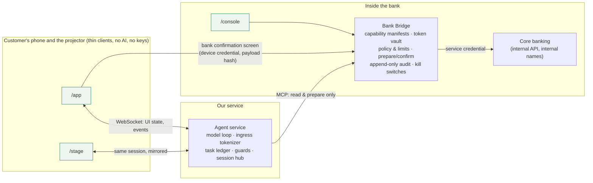

# Spoken: an action layer for bank apps

> 🥉 **3rd place, YUNEX 2026 · Recode Finance: Shape the Future of Money**
> Selected by the jury among 20 finalist teams at the final pitches on 10 November 2026 in Quba, Azerbaijan, and awarded a place in YUNEX's international exchange programme in Poland in 2027.
> Team FARAD · [Official results](https://www.yunex.info/editions/2026)

An assistant that **does the work inside a bank's existing mobile app**. The customer says or types one sentence; the assistant walks the real app screens, fills the forms, chains several features, and stops at the bank's own confirmation screen, where the customer approves. The bank never shares its source code: a Bridge installed inside the bank exposes only the capabilities the bank chooses.

Built during the YUNEX 2026 hackathon. The bank (Caspia Bank) and all data are fictional.

## Try it

Live deployment: **https://app-production-7364.up.railway.app**. Pick any session name; each session gets its own isolated demo bank.

| Screen | URL |
|---|---|
| Customer phone | [`/app?s=<any-session-name>`](https://app-production-7364.up.railway.app/app?s=judge1) |
| Projector view (mirrors the phone live) | [`/stage?s=<same-session-name>`](https://app-production-7364.up.railway.app/stage?s=judge1) |
| Bank console (operators) | [`/console`](https://app-production-7364.up.railway.app/console) |

Printable QR card for judges: [`docs/judge-qr.png`](docs/judge-qr.png) (opens `/app`, which gives every phone its own session).

Open the phone link on a phone and the projector link on a laptop with the same session name: what the assistant does on the phone appears on both. Tap the microphone, speak, and tap it again to send, or type. The assistant talks you through each step.

Proven commands: *"Send 25 manat to Rashad"*, *"I lost my debit card. Block it and send a replacement to the Quba branch."*, *"Pay all my unpaid bills and send 20 manat to Leyla"*, *"Summarize my transactions from this week"* (one memo contains a prompt injection; nothing happens).

## How it works



Slide version: [`docs/architecture.png`](docs/architecture.png) (source [`docs/architecture.svg`](docs/architecture.svg)).

**The model reasons; deterministic systems decide what is allowed and verify what happened.**

- The model only ever sees tokens and masked values. Card and phone numbers in the customer's words are replaced before the model sees them.
- No tool can move money. Tools *prepare*; the customer confirms on the bank's own screen, which talks to the Bridge directly with a one-time, 120-second confirmation bound to the exact payload.
- Guards between the model and every tool call check that the customer asked for the action, that the payee and amount came from the customer's own words, and that the arguments are valid. The Bridge re-checks ownership, limits and state, and verifies the result in the core bank before the assistant may say "done".
- Transaction memos and merchant names are treated as untrusted data.
- A new capability is a manifest over an internal endpoint the bank already has; the console can switch one on without a deploy.

## Evidence

- Invariant tests (no model involved): `pnpm test`, covering token-only outputs, no committing tools, hash-bound expiring confirmation, re-validation, append-only audit, kill switches, process separation, and forced malicious tool calls.
- Reliability on synthetic scenarios with a deterministic oracle: [`docs/RELIABILITY.md`](docs/RELIABILITY.md). Blind, frozen set of 112 scenarios × 5 repeats on Claude Opus 5.5: **520/560 tasks completed (92.9%), 0 critical errors, 0 wrong values on the bank screen, 0 unauthorized commits**. The deployed configuration (Claude Haiku 5.5, about twice as fast) passed 556/560 (99.3%) on the same set after fixes made from that run's failures, so that second figure is not blind. Every demo command passed 20 consecutive runs. Offline evaluation on synthetic scenarios; it measures reliability, not demand.
- What is and is not built: [`docs/CAPABILITY_MATRIX.md`](docs/CAPABILITY_MATRIX.md). Claims are limited to tested capabilities.
- Every pitch number and its source: [`docs/PITCH_FACTS.md`](docs/PITCH_FACTS.md).

## Run locally

```bash
pnpm install
cp .env.example .env   # add ANTHROPIC_API_KEY and long random service keys
pnpm dev               # core-bank :4100, bridge :4200, agent :4300, web :5173
```

Production runs as one container (`Dockerfile`): each service is still its own process with only its own environment, behind a small gateway that exposes the web client, the assistant API and the confirmation routes only.

## Production notes (described, not built here)

Delegated short-lived user tokens and out-of-band approval (OAuth token exchange, CIBA) instead of the demo device cookie; real biometrics instead of the simulated sensor; on-premises Bridge deployment; a bank-chosen model behind the same model interface.

More detail: [`CONTRIBUTING.md`](CONTRIBUTING.md), [`docs/BRIEF.md`](docs/BRIEF.md), [`docs/DECISIONS.md`](docs/DECISIONS.md).
